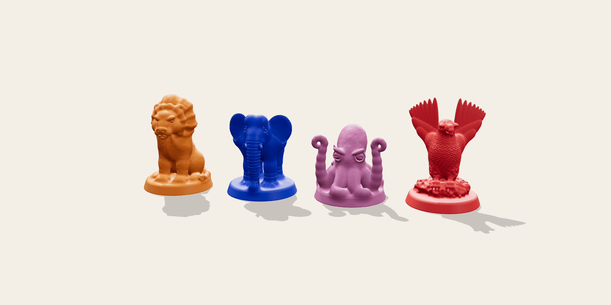
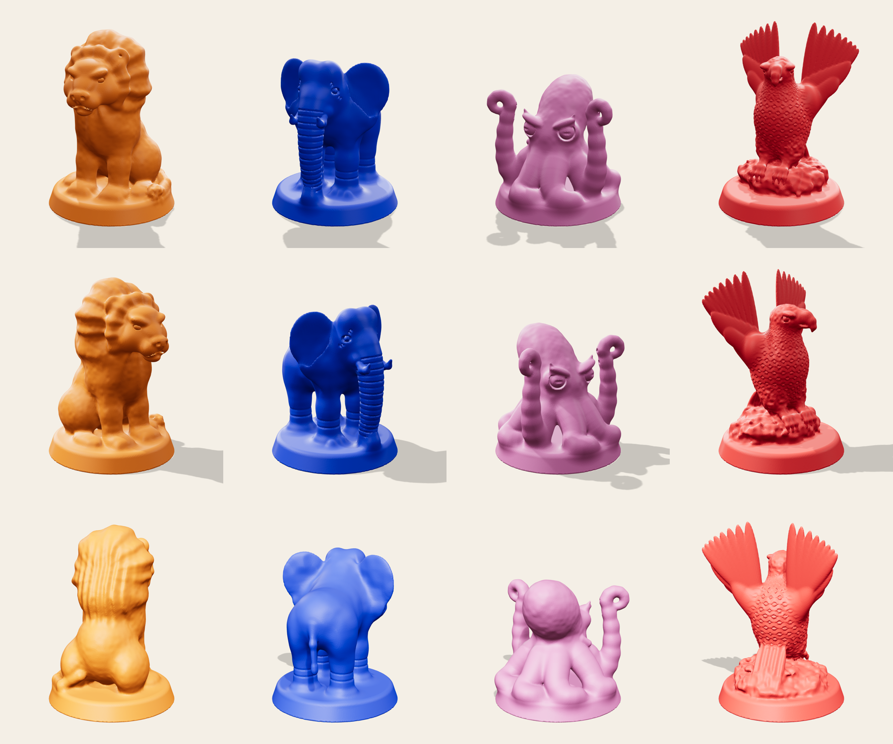

# Fichas 3D: león, elefante, pulpo y águila

Cuatro fichas de juego para imprimir en 3D. Cada animal está modelado completo
y se funde poco a poco con la base, sin uniones bruscas. El estilo es de figura
de colección, más serio que infantil.

| Ficha | Color | Archivo |
|---|---|---|
| León sentado, con melena | naranja | `stl/ficha-leon.stl` |
| Elefante de pie, con colmillos | azul | `stl/ficha-elefante.stl` |
| Pulpo con dos brazos alzados | rosado/morado | `stl/ficha-pulpo.stl` |
| Águila con las alas alzadas, sobre una roca | rojo | `stl/ficha-aguila.stl` |




## Medidas
- Base: 30 mm de diámetro y 4 mm de alto (igual en las cuatro).
- Alturas: león 41 mm, águila 42 mm, elefante 35 mm, pulpo 30 mm.
- Cada STL es una sola malla cerrada (estanca) en milímetros, con el fondo plano en z = 0.
  Si las necesitas más grandes o más pequeñas, escálalas en el slicer.

## Impresión recomendada (FDM)
- Altura de capa de 0.12 mm (o 0.08 mm si tu impresora lo permite) para que se vean la melena, las plumas y las arrugas.
- Boquilla de 0.4 mm. Relleno del 15 %, con 3 perímetros.
- Soportes **en árbol (tree)** solo donde toquen la placa:
  - Elefante: la panza, los colmillos y el borde inferior de las orejas.
  - Pulpo: los rizos de las puntas de los dos brazos alzados.
  - Águila y león: casi no los necesitan (quizá el pico y la barbilla).
- En resina salen sin problema, con la inclinación de siempre.

## Regenerar los modelos
Los modelos se describen con código (campos de distancia con uniones suaves):
- `sdf.py`: primitivas y operaciones.
- `animales.py`: cada animal.
- `construir.py`: genera los STL.

```bash
pip install numpy scikit-image trimesh fast-simplification
python3 construir.py 0.2            # todas las fichas (resolución 0.2 mm)
python3 construir.py 0.3 aguila     # vista previa rápida de una sola
```
Las imágenes se hacen con `render/` (three.js + Playwright).
